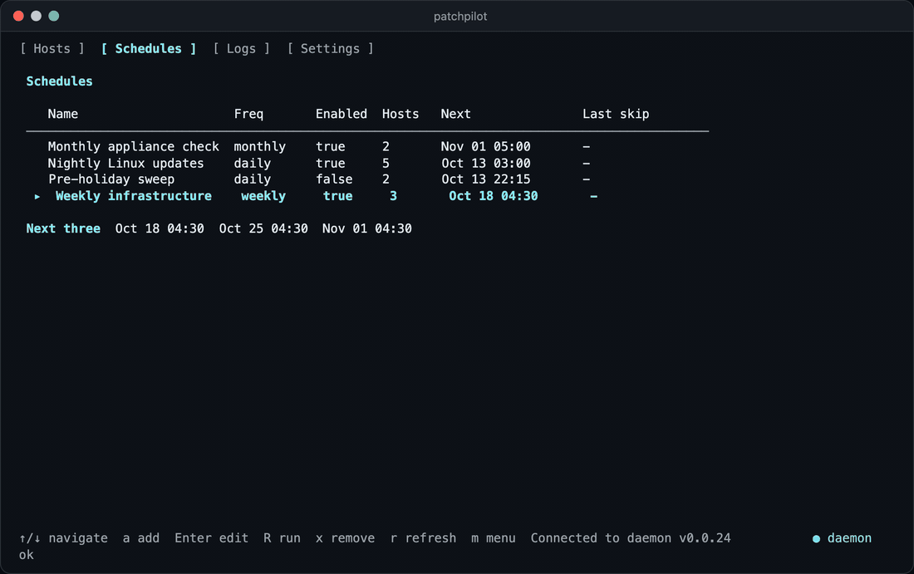
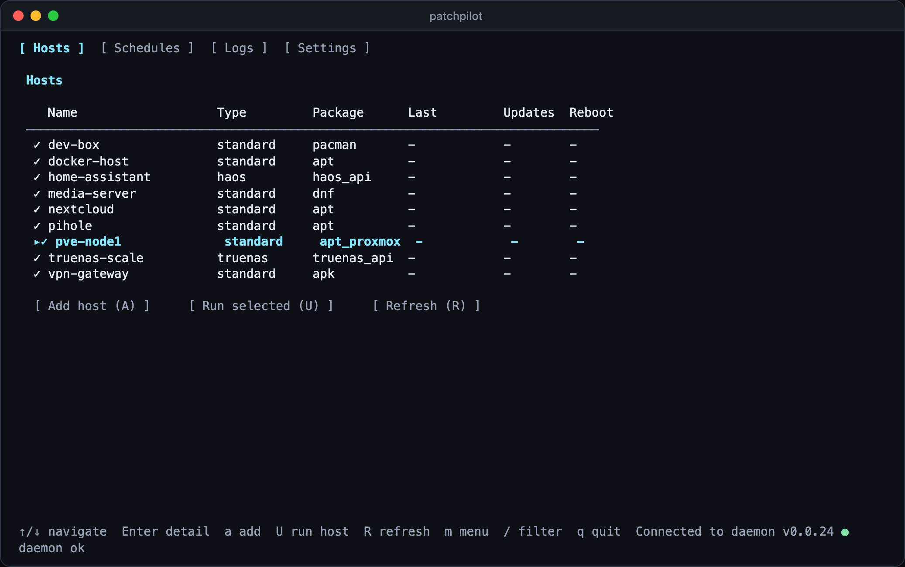
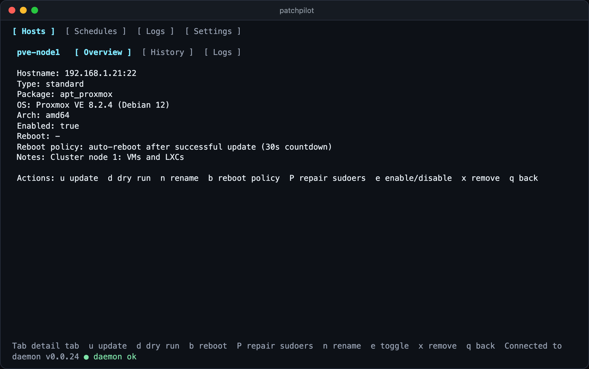
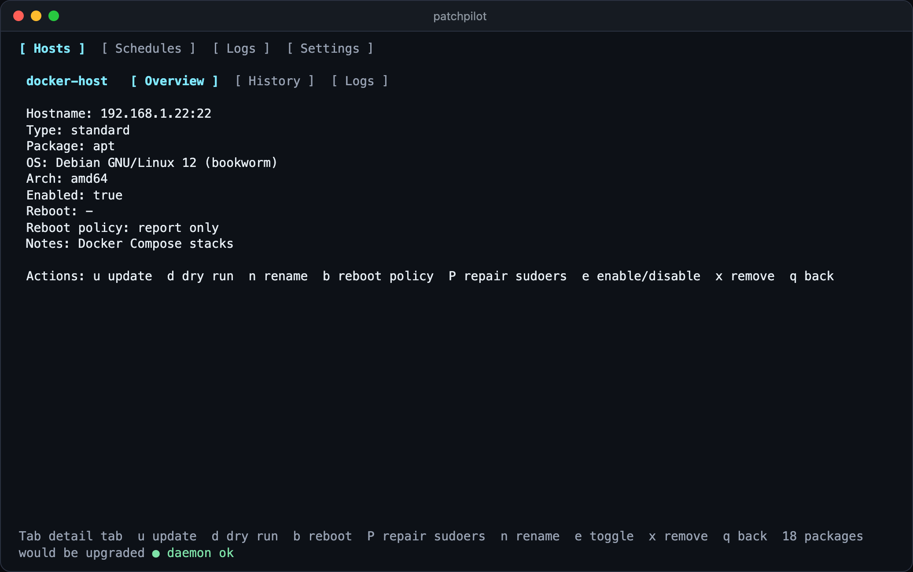
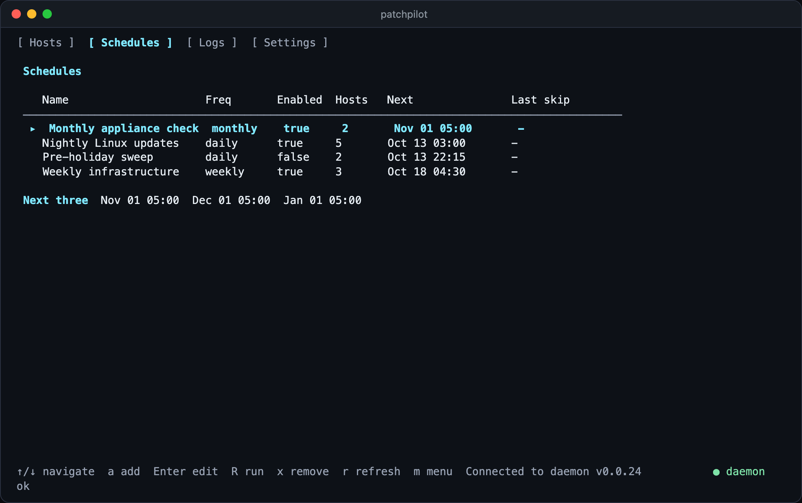
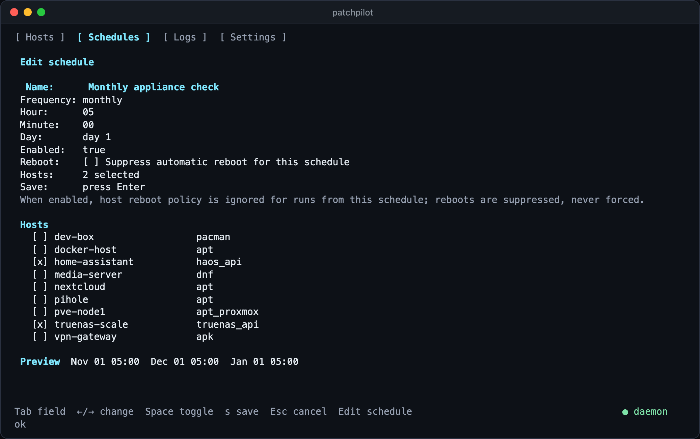
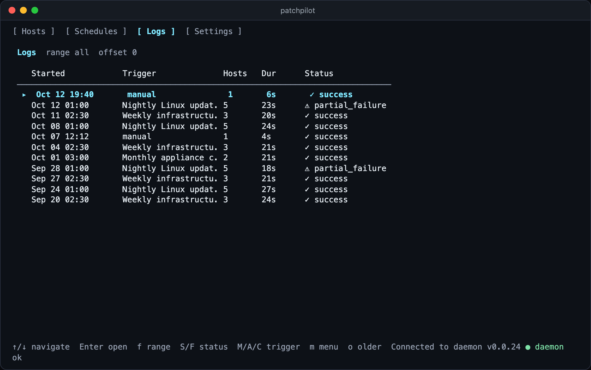
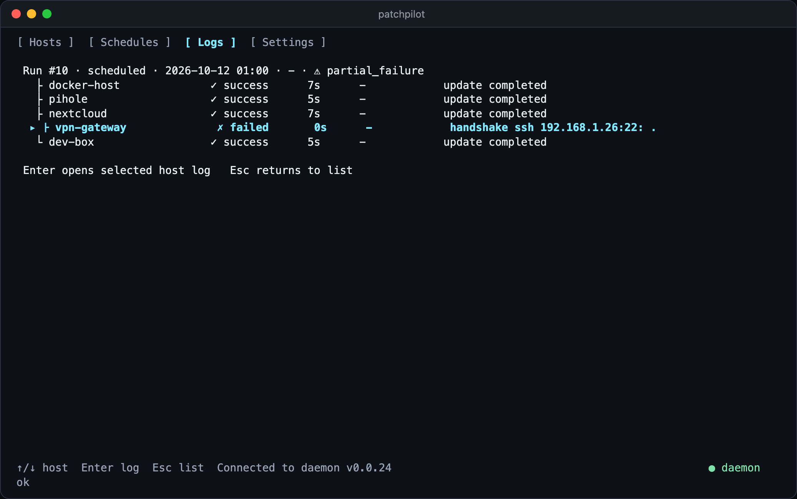
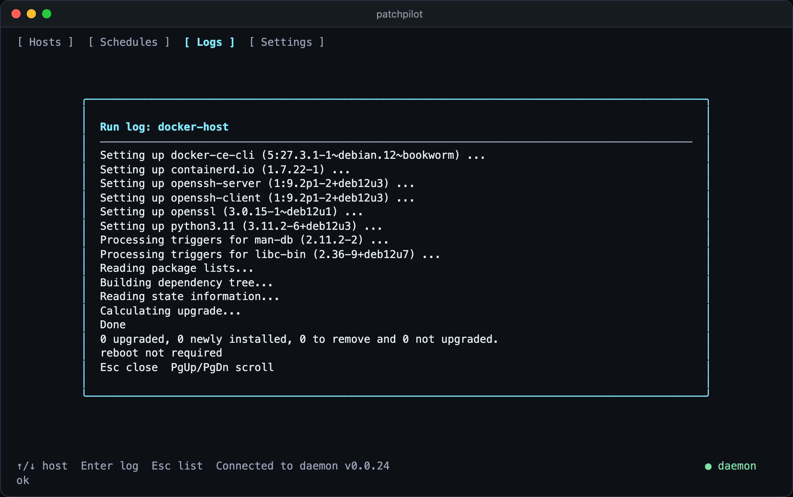
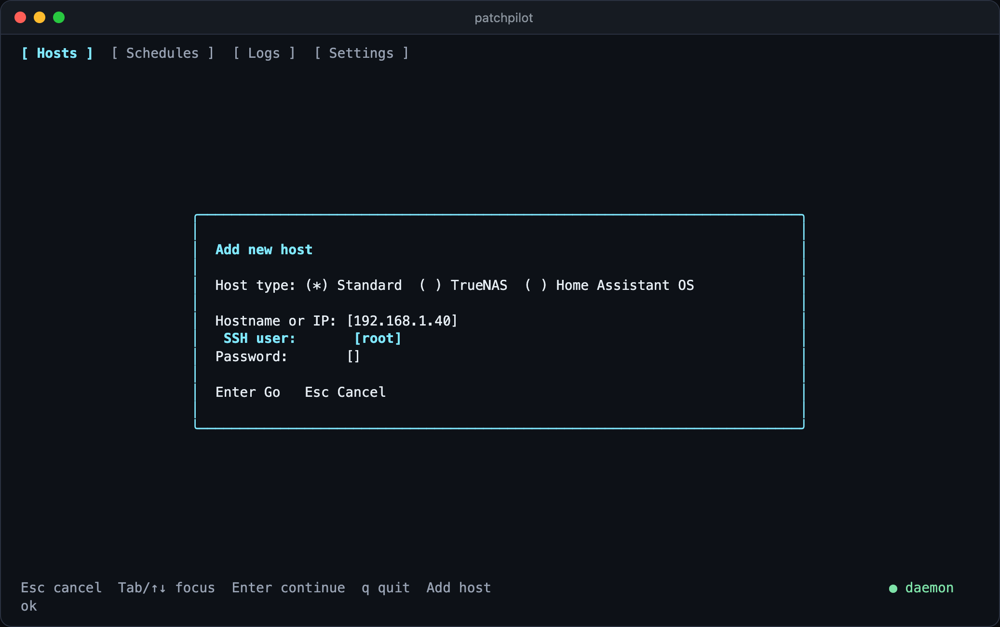

<div align="center">

# patchpilot

**One quiet terminal for keeping a whole homelab patched.**<br>
Linux VMs and LXCs, Proxmox nodes, TrueNAS SCALE and Home Assistant OS, updated on a schedule from a single small daemon.

<p>
  <a href="LICENSE"></a>
  
  
  
</p>



</div>

---

## Why patchpilot

Keeping ten machines patched by hand means ten SSH sessions, three different package managers and one appliance that wants a click in a web UI. patchpilot turns that into a single list: pick the hosts, pick a time, and read one log when it is done.

- **Nothing to install on your hosts.** It talks plain SSH to Linux machines and the native HTTP API to TrueNAS SCALE and Home Assistant OS.
- **Built for homelabs, not fleets.** One binary, one SQLite file, one systemd unit. No database server, no web stack, no agents.
- **Keyboard-first and scriptable.** A full-screen terminal UI for people, a small CLI for cron and scripts.
- **Careful by default.** Reboots are never automatic unless you ask for them, runs never overlap, and every credential is stored encrypted.

## What you get

| | |
|---|---|
| **Many kinds of host** | Debian and Ubuntu (`apt`), Proxmox VE (`apt` with Proxmox awareness), Fedora and RHEL family (`dnf`), Arch (`pacman`), openSUSE (`zypper`), Alpine (`apk`), TrueNAS SCALE and Home Assistant OS. |
| **Schedules** | Hourly, daily, weekly or monthly, each with its own host list, a preview of the next three fire times, and an optional "never reboot for this schedule" switch. |
| **Dry runs** | Ask any host what *would* change (package count, download size) without touching it. |
| **Live runs** | Start a run and watch every host's output stream in. Cancel it if something looks wrong. |
| **Full history** | Every run and every host's log is kept, filterable by time range, status and trigger. |
| **Reboot control** | A host can be flagged as needing a reboot after an update. Opt in per host to a countdown with a cancel button. |
| **Safe onboarding** | A wizard creates a dedicated `patchpilot` account on each Linux host with a minimal sudoers whitelist. Your own account is never reused. |
| **Key rotation** | Rotate the orchestrator SSH key across every host in one action, all-or-nothing. |
| **Backup and restore** | Export hosts and schedules to YAML, import with skip / overwrite / rename on conflicts. |
| **Updates itself** | The machine running patchpilot can be one of its own hosts. |

## A tour

### Your whole fleet at a glance

Every host with its type, package manager and state. Filter with `/`, run the selected host with `U`.



### Look before you leap

Open a host and press `d` for a dry run. You get the number of packages and the download size, and nothing on the machine changes.

<table>
<tr>
<td width="50%"></td>
<td width="50%"></td>
</tr>
</table>

### Schedules that read like sentences

Name it, pick a frequency, tick the hosts. The editor shows the next three fire times as you change things, so there are no cron surprises.

<table>
<tr>
<td width="50%"></td>
<td width="50%"></td>
</tr>
</table>

### History you can actually read

Every run is kept. Open one to see which hosts succeeded, which failed and why, then open any host to read its full output.

<table>
<tr>
<td width="50%"></td>
<td width="50%"></td>
</tr>
</table>



> [!NOTE]
> The screenshots and the animation above come from a simulated fleet: nine pretend machines on a loopback test harness, with stand-in package managers and fake TrueNAS and Home Assistant APIs. The interface and the daemon are the real thing; the hosts are not. No real machine, address or credential appears anywhere in this repository.

## Requirements

**The machine that runs patchpilot** (the "orchestrator")

- Linux with systemd. A small Debian 12 LXC or VM is the tested target.
- It must be able to reach every managed host: SSH (port 22 by default) for Linux hosts, HTTP(S) for TrueNAS and Home Assistant.
- A UTF-8 locale, otherwise the terminal UI draws garbage.
- Very little else. It idles between runs; the disk use is the binary, a small database and your run logs.

**Each Linux host you want to manage**

- An SSH server and a way to log in once during onboarding (a password or an existing key for an account that can use `sudo`).
- One of `apt`, `dnf`, `pacman`, `zypper` or `apk`.

**TrueNAS SCALE** needs an API key. **Home Assistant OS** needs a long-lived access token. TrueNAS CORE is not supported.

## Install

There are no prebuilt downloads yet, so you build the release tarball yourself. You need Go 1.23 or newer and `make` on any machine.

```bash
git clone https://github.com/TheOriUHD/patchpilot.git
cd patchpilot
make release VERSION=v0.0.24
```

That produces tarballs for Linux and macOS under `dist/release/`, each with a checksum. Copy the Linux one to the machine that will run patchpilot and install it:

```bash
scp dist/release/patchpilot-v0.0.24-linux-amd64.tar.gz root@YOUR-LXC:/tmp/
ssh root@YOUR-LXC

cd /tmp
tar -xzf patchpilot-v0.0.24-linux-amd64.tar.gz
cd patchpilot-v0.0.24-linux-amd64
sha256sum -c patchpilot.sha256     # optional, verifies the binary
./install.sh
systemctl start patchpilot
```

Use `linux-arm64` instead if the orchestrator is a Raspberry Pi or another ARM board.

If you would rather push the build straight from your workstation, this does the copy and the install in one go:

```bash
make install LXC_HOST=YOUR-LXC LXC_USER=root
```

The installer creates a `patchpilot` system user, the data and log directories, the orchestrator's SSH key and the encryption key for stored tokens, then enables the service. At the end it prints the orchestrator **public key**. You do not need to copy it anywhere by hand, the onboarding wizard installs it for you. Re-running the installer later upgrades the binary and keeps everything else.

Open the interface any time with:

```bash
patchpilot tui
```

## First setup

Five minutes, start to finish.

1. **Add a Linux host.** On the **Hosts** tab press `a`, leave the type on *Standard*, and enter the hostname or IP, an SSH user that can `sudo`, and its password. patchpilot signs in once, creates a `patchpilot` account, installs its key, detects the package manager and writes a sudoers entry limited to the exact commands it needs. The password is used for that one step and then discarded.

   

2. **Check it with a dry run.** Open the host with `Enter`, press `d`, and confirm the package count looks sane.
3. **Add appliances if you have them.** Choose *TrueNAS* or *Home Assistant OS* in the same wizard and paste the API token.
4. **Create a schedule.** Switch to the **Schedules** tab with `Tab`, press `a`, give it a name, pick a frequency and time, and tick the hosts. Press `s` to save.
5. **Try it once by hand.** Select the schedule and press `R`. Watch the run, then look at it again on the **Logs** tab.

From then on patchpilot runs on its own. You only need to open the interface when you want to look.

## Everyday use

### Keys

| Where | Keys |
|---|---|
| Everywhere | `Tab` next tab, `m` menu, `q` quit, `Esc` back |
| Hosts | `a` add, `Enter` detail, `U` update selected, `R` refresh, `/` filter |
| Host detail | `u` update, `d` dry run, `n` rename, `b` reboot policy, `e` enable or disable, `P` repair sudoers, `x` remove |
| Schedules | `a` add, `Enter` edit, `R` run now, `x` remove |
| Logs | `Enter` open, `f` time range, `S` / `F` status filter, `M` / `A` / `C` trigger filter, `o` older |
| Live run | `K` cancel, `PgUp` / `PgDn` scroll, `Esc` minimize |
| Settings | `t` concurrency, `k` rotate key, `e` export, `i` import |

### Command line

The same daemon is reachable from scripts:

```bash
patchpilot host list
patchpilot host run 3              # update one host now
patchpilot host credential ...     # set a TrueNAS / HAOS token
patchpilot schedule list
patchpilot schedule run 2          # fire a schedule now
patchpilot schedule add ...
```

Adding a Linux host is done in the interface, because it needs a one-time password prompt.

### Reboots

Updating and rebooting are separate decisions.

- After an update patchpilot checks whether the host *needs* a reboot (`/var/run/reboot-required` and `needrestart` on apt, `needs-restarting` on dnf, running-versus-installed kernel on pacman, zypper and apk) and records it.
- Per host you can choose **auto-reboot** with a countdown of your choosing. When a run finishes with the interface open, a countdown appears and `Cancel` aborts it.
- Per schedule you can tick **Suppress automatic reboot**, which skips the check entirely for runs started by that schedule. This is how the schedule in the animation above ran.
- Hosts are rebooted one at a time with a gap between them.

> [!IMPORTANT]
> The countdown is driven by the terminal interface. A fully unattended schedule will mark hosts as *reboot required* and leave them running; it will not reboot anything on its own. Open the interface (or run it in `tmux`) if you want the countdown to fire.

## For advanced users

<details>
<summary><b>How it works</b></summary>

<br>

patchpilot is one binary with two modes.

- `patchpilot daemon` is the orchestrator: SQLite store, scheduler, run executor, log streamer and a Unix-socket API.
- `patchpilot tui` and the `host` and `schedule` commands are thin clients of that socket.

Linux hosts are managed over SSH with a dedicated ed25519 key. TrueNAS SCALE uses `/api/v2.0/...` with a bearer key and polls the update job to completion. Home Assistant OS uses the Supervisor proxy under `/api/hassio/...` and always updates the Supervisor before Core. Migrations run at startup, runs are serialized, and run logs are written under `/var/log/patchpilot/runs`.

</details>

<details>
<summary><b>Concurrency</b></summary>

<br>

Runs are sequential by default. In **Settings** you can enable experimental parallelism (up to 10 at a time) for standard, non-Proxmox Linux hosts. TrueNAS, Home Assistant OS, Proxmox hosts and the patchpilot machine itself always run one at a time.

A scheduled run that fires while another run is active is skipped and the skip is recorded on the schedule. Manual and CLI runs queue instead.

</details>

<details>
<summary><b>Files and configuration</b></summary>

<br>

```text
/etc/patchpilot/config.yaml            paths (the only config file)
/etc/patchpilot/secret.key             32-byte key that encrypts stored API tokens
/var/lib/patchpilot/patchpilot.db      inventory, schedules, history
/var/lib/patchpilot/ssh/id_ed25519     orchestrator SSH key
/var/log/patchpilot/daemon.log         daemon log
/var/log/patchpilot/runs/              per-host run logs
/run/patchpilot/patchpilot.sock        client socket
```

Every path can be overridden with an environment variable, which is how `make run-daemon` and `make run-tui` work without root:

`PATCHPILOT_CONFIG`, `PATCHPILOT_DATA_DIR`, `PATCHPILOT_DB_PATH`, `PATCHPILOT_SOCKET_PATH`, `PATCHPILOT_LOG_PATH`, `PATCHPILOT_SECRET_KEY_PATH`

Clients read only the socket. Point them elsewhere with `PATCHPILOT_SOCKET`.

</details>

<details>
<summary><b>Security model</b></summary>

<br>

- The daemon runs as an unprivileged `patchpilot` user under a hardened systemd unit with a restricted set of writable paths.
- Remote access is a dedicated `patchpilot` account on each host whose sudoers entry lists exact, absolute command paths (package manager, reboot) and nothing else, with `NOPASSWD`. Treat the orchestrator key like any other automation credential.
- API tokens for TrueNAS and Home Assistant are encrypted at rest. Someone who holds both the database and `secret.key` can decrypt them, so back both up carefully and separately.
- Backups never contain tokens.
- Onboarding passwords are held in memory for the one wizard run and wiped afterwards.

</details>

<details>
<summary><b>Key rotation</b></summary>

<br>

**Settings → `k`** generates a new keypair, installs it on every enabled Linux host, verifies each one can log in with it and only then replaces the local key and removes the old public key from the hosts. If any host rejects the new key, the new key is removed again from the hosts that accepted it and the old local key stays in place. Fix or disable unreachable hosts and retry.

</details>

<details>
<summary><b>Backup and restore</b></summary>

<br>

**Settings → `e`** writes a YAML inventory (`format_version: 1`) with hosts, schedules, their links and the concurrency setting. **`i`** imports one, reporting name conflicts before anything changes so you can pick skip, overwrite or rename. Overwriting keeps the existing tokens for that host because backups do not contain them.

</details>

<details>
<summary><b>Service management</b></summary>

<br>

```bash
systemctl status patchpilot
journalctl -u patchpilot -f
tail -f /var/log/patchpilot/daemon.log
```

The unit restarts on failure after 5 seconds and gives up after 3 crashes in 60 seconds, so a broken install shows up as a clearly failed service instead of a loop. The previous binary is kept as `/usr/local/bin/patchpilot.prev` on every upgrade.

</details>

## What it does not do

Better to know now than to find out at 3 a.m.

- **No notifications.** There is a placeholder in Settings; nothing is sent anywhere yet. Check the Logs tab or `journalctl`.
- **No unattended reboots.** See [Reboots](#reboots).
- **No web interface.** It is terminal only.
- **No Windows or macOS hosts**, and no TrueNAS CORE.
- **No package pinning, holds or policy engine.** It runs the package manager's normal upgrade.
- **No rollback.** If an update breaks a host, patchpilot will not undo it. Take your snapshots first.
- **No clustering.** One daemon, one machine. Two orchestrators will not coordinate.

## Troubleshooting

| Symptom | Try |
|---|---|
| Daemon will not start | `journalctl -u patchpilot -n 100`. Check that `secret.key` is exactly 32 bytes and the paths in `config.yaml` are writable by the `patchpilot` user. |
| Interface cannot connect | `systemctl start patchpilot`, then `ls -l /run/patchpilot/patchpilot.sock`. For development runs make sure daemon and client use the same socket path. |
| Garbled interface | Install a UTF-8 locale (`locales`, then `dpkg-reconfigure locales`). The installer warns about this. |
| Onboarding fails | Check DNS, the SSH port and the credentials. The first account must be allowed to create users, write to `/etc/sudoers.d` and edit `authorized_keys`. |
| `permission denied` on a managed host | Open Settings, copy the public key and make sure it is in the remote `patchpilot` user's `authorized_keys`. |
| `sudo` errors during updates | Open the host and press `P` to repair the sudoers entry. |
| A schedule did not fire | Is it enabled, does it have enabled hosts, and is the orchestrator's clock right? A schedule that fires during another run is skipped and noted in *Last skip*. |
| TrueNAS or HAOS authentication fails | Create a fresh token and update the host. Confirm the address and port. |
| Key rotation aborts | One enabled host was unreachable or rejected the key. Fix it or disable it, then retry. The old key is untouched. |

## Building from source

```bash
make test        # go test ./...
make build       # dist/patchpilot for this machine
make check       # vet + golangci-lint + tests
make run-daemon  # unprivileged daemon with state in ~/.patchpilot
make run-tui     # connect to it (run in a second terminal)
```

The source layout is conventional Go: `cmd/patchpilot` is the entry point, `internal/` holds the orchestrator, scheduler, per-distro package-manager logic, the TrueNAS and Home Assistant clients and the terminal UI. Migrations live in `migrations/`.

## License

patchpilot is source-available under the [PolyForm Noncommercial License 1.0.0](LICENSE). You may use, modify and redistribute it for any noncommercial purpose, including personal homelabs, hobby projects, education and research, provided the license and the required notice stay with it. Commercial use is not permitted without a separate agreement.

Third-party components are listed in [THIRD-PARTY-NOTICES.md](THIRD-PARTY-NOTICES.md).

Bugs and ideas: [open an issue](https://github.com/TheOriUHD/patchpilot/issues).
